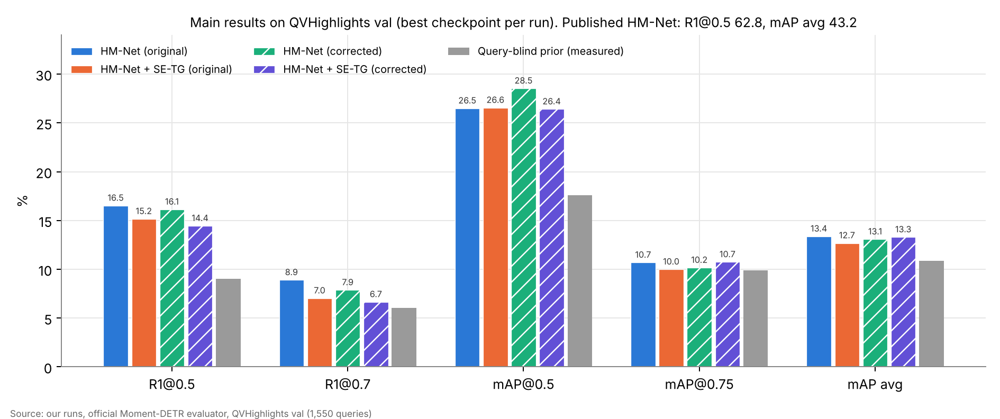
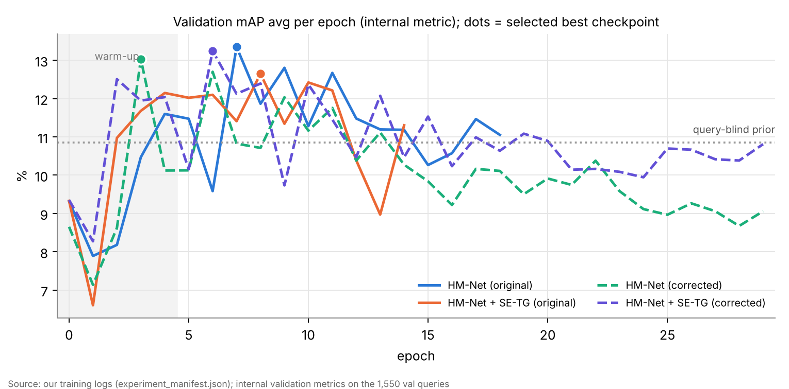

# HM-Net + SE-TG on QVHighlights

Re-implementation of **HM-Net** (Hierarchical Hybrid Mamba Network, *Scientific Reports* 16:15847, 2026,
doi:10.1038/s41598-026-44804-x) for video moment retrieval, plus our extension **SE-TG**
(Sub-Event Temporal Grounding) for compound queries. DAC-301 course project, IIT Roorkee.

> **Status (26 Nov 2026).** Code complete and tested (46 tests). Trained on the IIT Roorkee MFS GPU
> cluster under limited compute (15–30 epochs of a 50-epoch schedule). Our models reach **≈ 13 mAP avg**
> on QVHighlights val — only ≈ 2.5 points above a query-blind prior and far below the published 43.2.
> Validation peaks within the first 3–8 epochs and then **overfits** (validation loss rises while training
> loss falls). **SE-TG shows no significant difference** from the baseline (paired tests; we fail to reject
> H0). All numbers are real measurements; nothing is estimated.

## What is in this repository

| Path | Content |
|---|---|
| `src/models/` | HM-Net: input projection, HMB block (cross-attention, context modulation, positional bias, bidirectional Mamba with a pure-PyTorch selective scan), enhancement encoder, symmetric co-fusion, DETR decoder |
| `src/setg/` | SE-TG: spaCy sub-event parser, exact CLIP token alignment, sub-event embeddings, video alignment (fp32), zero-initialised gated injection |
| `src/losses/` | Hungarian matching, CE + L1 + gIoU, saliency max-margin, MESM reconstruction, SE-TG containment / diversity |
| `src/data/` | manifest dataset, official-style modality alignment, optional L2 normalisation |
| `scripts/` | `train.py`, `evaluate.py` (official-format predictions), `demo_inference.py` (live demo), validators |
| `configs/default.yaml` | original settings (as in the team code) |
| `configs/fixed.yaml` | + L2 feature normalisation and background weight 0.1 (official Moment-DETR pipeline) |
| `cluster/` | Slurm scripts used on MFS: single run, two runs in one job with auto-resume / hold-GPU-on-error, add-a-run, memory guard, evaluate-all |
| `data_prep/` | manifest fix for the 8 queries longer than the 32-token text features |
| `docs/` | architecture, audit (9 bugs found and fixed), protocols, troubleshooting; `ORIGINAL_README.md` |
| `tests/` | 46 unit tests (`python -m pytest -q`) |

## Architecture

Video (SlowFast 2304 ⊕ CLIP 512 per 2-s clip) and query (CLIP text, ≤ 32 tokens) → linear projection to 256
→ 2 × HMB enhancement (video ← text) → 2 × symmetric co-fusion (video ↔ text) → *[SE-TG: sub-event alignment
+ gated injection, γ = 0 at start]* → DETR decoder (10 slots) → class + span.
Losses: 6·CE + 10·L1 + 1·gIoU + 1·saliency + 0.1·reconstruction (+ 0.1·containment + 0.1·diversity for SE-TG).
SE-TG adds **1,281 parameters** (29,989,654 → 29,990,935).

## Setup

```bash
python -m venv venv && source venv/bin/activate
pip install torch==2.14.1 --index-url https://download.pytorch.org/whl/cu130
pip install -r requirements.txt pytest nbformat && python -m spacy download en_core_web_sm
python -m pytest -q            # 46 passed
```

**Data.** Official Moment-DETR QVHighlights features (`slowfast_features`, `clip_features`, `clip_text_features`;
the original link has expired, we used the CG-DETR mirror). Do **not** use `clip_sub_features` (subtitles) as
query features. Manifests are built from the official `highlight_{train,val}_release.jsonl`; then run
`python data_prep/fix_manifest_token_length.py <manifest_dir> <feature_root>`.

## Training, evaluation, demo

```bash
python scripts/train.py --config configs/fixed.yaml --manifest <m>/fixed/train.jsonl --val-manifest <m>/fixed/val.jsonl \
  --feature-root <features> --run-name hmnet_setg_fix --fresh \
  --set paths.drive_root=<runs> train.epochs=50 train.batch_size=32 train.grad_accum=1 model.use_setg=true

python scripts/evaluate.py --config <cfg> --manifest <m>/fixed/val.jsonl --feature-root <features> \
  --checkpoint <best.pt> --output-dir out/
cd moment_detr && PYTHONPATH=. python standalone_eval/eval.py --submission_path out/predictions_official.jsonl \
  --gt_path data/highlight_val_release.jsonl --save_path out/metrics_official.json

python scripts/demo_inference.py --config <cfg> --checkpoint <best.pt> --manifest <m>/fixed/val.jsonl \
  --feature-root <features> --qids 2043 --random 3
```

On a Slurm cluster: `sbatch cluster/both.sbatch` (baseline + SE-TG in one job; resumes from checkpoints,
retries, and keeps the GPU for up to 2 h on repeated failure).

## Results (QVHighlights val, official evaluator)

Best checkpoint per run (by validation mAP avg). Full tables, subsets and paired tests: [`RESULTS_TABLES.md`](RESULTS_TABLES.md); raw predictions, official metrics, histories and logs: `results/`; figures: `figures/`.

| Model | Settings | Epochs | R1@0.5 | R1@0.7 | mAP@0.5 | mAP@0.75 | mAP avg |
|---|---|---|---|---|---|---|---|
| Random windows (measured) | — | — | 8.77 | 2.39 | 15.03 | 3.41 | 5.43 |
| Query-blind prior (measured) | — | — | 9.03 | 6.06 | 17.58 | 9.87 | 10.85 |
| HM-Net (ours) | original | 19 (best 7) | 16.52 | 8.90 | 26.49 | 10.69 | 13.37 |
| HM-Net + SE-TG (ours) | original | 15 (best 8) | 15.16 | 7.03 | 26.55 | 9.99 | 12.68 |
| HM-Net (ours) | fixed | 30 (best 3) | 16.13 | 7.87 | 28.53 | 10.16 | 13.07 |
| HM-Net + SE-TG (ours) | fixed | 30 (best 6) | 14.45 | 6.65 | 26.40 | 10.74 | 13.29 |
| HM-Net (published, Table 2) | — | n/a | 62.77 | 48.13 | 63.14 | 43.70 | 43.17 |

**Key findings (all measured):**
- **Overfitting:** validation mAP peaks at epochs 3–8; afterwards training loss keeps falling while validation loss rises (corrected runs: ≈ 5 → 13). See `figures/R2_*`, `figures/R3_*`.
- **SE-TG vs baseline:** Δ mAP avg −0.70 [−1.61, +0.21] (original) and +0.23 [−0.67, +1.14] (corrected); Δ R1@0.5 McNemar p = 0.20 / 0.14. On compound queries (n = 234): Δ R1@0.5 −3.85 / +2.14, both n.s. → **fail to reject H0**. Because the baseline itself barely beats the query-blind prior, this is inconclusive about SE-TG rather than evidence against it.
- **Original vs corrected settings** (L2 normalisation + background weight 0.1): no significant change.
- **Weak spots:** short moments (< 10 s) mAP ≈ 0.2–1.0 vs long moments ≈ 21–23; the corrected SE-TG model ends 62.1 % of its top-1 windows at the video end (ground truth: 22.9 %).




## Engineering notes (problems we solved)

Data-loader schema mismatch; SlowFast/CLIP off-by-one lengths (official truncation); 2,888 missing text
features (restored from the official release); padding leak in the backward Mamba scan (masked flip);
mis-scaled reconstruction loss (MESM formulation); 32-token text features vs longer queries; DataLoader
`received 0 items of ancdata` (file_system sharing); **fp16 overflow → NaN in SE-TG alignment** (fp32
alignment + skip-NaN-batch guard); crash-resilient Slurm scripts that keep the GPU; memory measured from the
job cgroup (sstat double-counts shared memory). Details in `docs/` and the project report.

## Limitations

Short training (shared GPUs, one job per account), pure-PyTorch Mamba instead of the official CUDA kernel,
validation split only, single seed. The models overfit early and stay near the query-blind level for both
settings; open candidate causes: the Mamba fallback, too little regularisation for this dataset size,
auxiliary losses overpowering localisation, or a remaining issue in how the query reaches the decoder.
Next steps: official Mamba kernel, stronger regularisation / early stopping, 3 seeds, test-server submission,
SE-TG order and boundary losses.

## References

HM-Net (Sci. Rep. 2026) · Moment-DETR / QVHighlights (Lei et al., NeurIPS 2021) · MESM (AAAI 2024) ·
QD-DETR (CVPR 2023) · CG-DETR (feature mirror) · Mamba (Gu & Dao, 2023).
