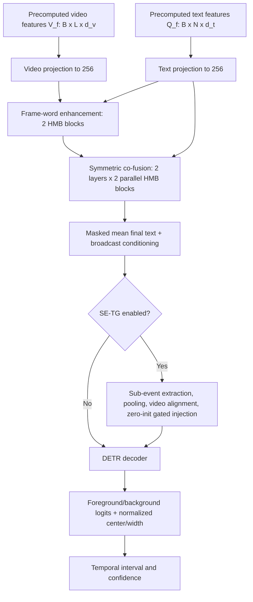
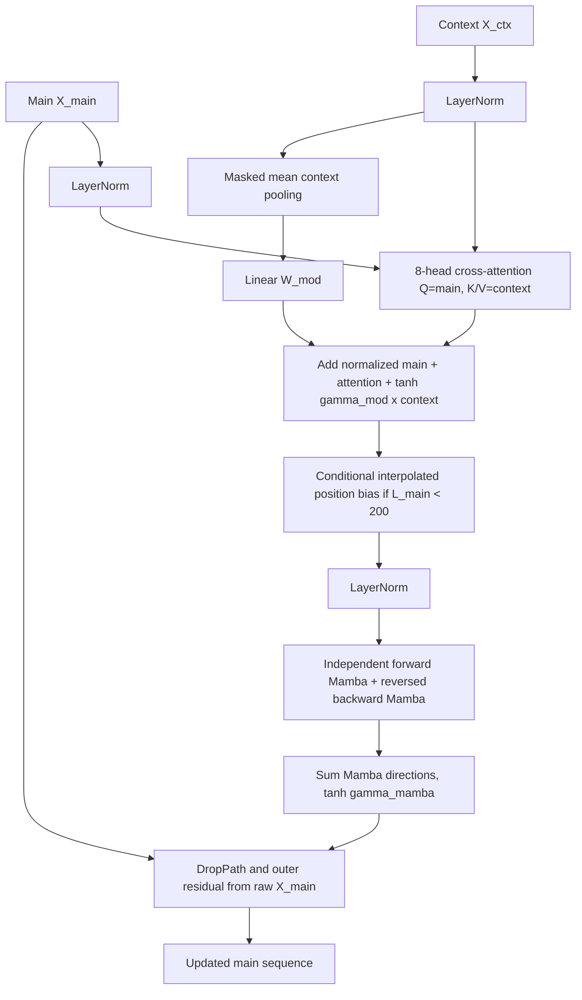

# Architecture walkthrough

## End-to-end flow

## Tensor dimensions
Let `B` be batch size, `L` video length, `N` query-token length, `D=256` hidden size, `H=8` attention heads, `Kmax=4` event channels and `Qd=10` object queries by default.

| Stage | Tensor | Shape |
|---|---|---|
| Video input | `V_f` | `[B,L,d_v]` |
| Text input | `Q_f` | `[B,N,d_t]` |
| Projection | `V,Q` | `[B,L,D]`, `[B,N,D]` |
| Enhancement | `V_enh` | `[B,L,D]` |
| Co-fusion | `V_fusion,Q_final` | `[B,L,D]`, `[B,N,D]` |
| SE-TG event vectors | `E` | `[B,Kmax,D]` |
| SE-TG alignment | `A` | `[B,Kmax,L]` |
| Injected memory | `V_SE_TG` | `[B,L,D]` |
| DETR decoder output | `H_dec` | `[B,Qd,D]` |
| Predictions | logits/spans | `[B,Qd,2]`, `[B,Qd,2]` |

## HMB block

1. Cross-attention provides fine-grained token-to-token cross-modal alignment.
2. Masked context pooling gives a robust global summary and `W_mod` maps it into the main feature space.
3. A learned positional table is linearly interpolated to sequence length and added only when `L_main < 200`.
4. Independent Mamba modules process the fused sequence forward and backward; reverse the backward output back into original time order.
5. The block returns `X_main + DropPath(X_fused + tanh(gamma_mamba)*(O_fwd+O_bwd))`.

The paper says its scalar gates initialize near zero but does not publish their exact numeric initial values. This code uses a configurable small near-zero initialization for the original HMB gates. SE-TG's gate is different: its exact required initialization is zero.

## Two-stage fusion
- **Frame-word enhancement:** two sequential HMB blocks update only video, with text as context.
- **Symmetric co-fusion:** two layers, each with a video-updating HMB and a text-updating HMB. Both consume the old layer states; updates are not chained within a layer.
- After the final layer, masked-mean-pool final text and add the vector to every video timestep.

## DETR head
The model owns a fixed set of learnable object queries. A Transformer decoder applies self-attention among queries and cross-attention to fused video memory. One head predicts two classes (background/foreground); the other predicts normalized `[center,width]`. Hungarian matching assigns predictions to ground-truth intervals; unmatched queries are background.

The paper's method section calls this a standard Transformer decoder over fused memory. No extra Transformer encoder is added here.
